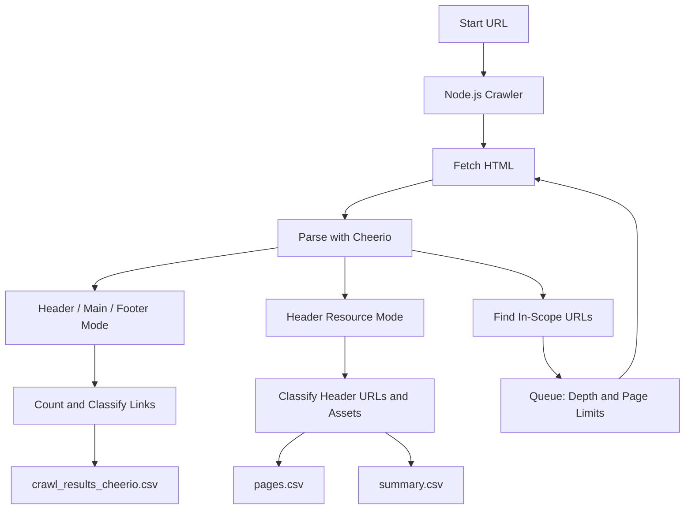

# WebsiteCrawler – Structural Website Analysis

A configurable website crawler built with **Node.js, JavaScript, Cheerio, and GitHub Actions**.

The project provides two crawling modes for analyzing website navigation, counting links, identifying resources, and exporting structured results to CSV files.

Both crawlers can run locally or through manually triggered GitHub Actions workflows.

> **Project status:** Functional implementation available for review. JavaScript syntax has been checked, but end-to-end crawling has not been independently tested.

## Overview

WebsiteCrawler analyzes the HTML structure of a website without launching a browser.

It provides two independent tools:

1. **Header/Main/Footer Crawler** – Counts and classifies hyperlinks in different page sections.
2. **Header Resource Crawler** – Collects URLs from header elements, including links, images, scripts, stylesheets referenced through HTML attributes, and other resources.

Both tools support recursive crawling with configurable limits.

The results can be downloaded as CSV artifacts from GitHub Actions.

## Features

- Recursive website traversal using a FIFO queue
- HTML parsing with Cheerio
- Header, main-content, and footer link analysis
- Header resource discovery and classification
- Internal and external URL classification
- URL normalization and duplicate filtering
- Configurable maximum crawl depth
- Configurable maximum page count
- Same-origin and optional subdomain restrictions
- Filtering of selected tracking parameters
- Semicolon-separated CSV export
- Manually triggered GitHub Actions workflows
- Execution without a headless browser

## Technology Stack

| Technology | Purpose |
|---|---|
| JavaScript | Application logic |
| Node.js | Runtime environment |
| Cheerio | Server-side HTML parsing |
| node-fetch | HTTP requests and redirects |
| Node.js URL API | URL resolution and normalization |
| Node.js File System API | CSV file generation |
| GitHub Actions | Cloud-based workflow execution |

The project uses CommonJS modules.

## Architecture



The diagram represents the two alternative crawling modes. They are separate scripts and do not need to run together.

## Crawling Modes

### 1. Header/Main/Footer Crawler

**File:** `crawlHeaderMainFooter_cheerio.js`

This crawler analyzes hyperlinks found in three website regions.

| Region | Detection |
|---|---|
| Header | First matching header container |
| Footer | Last matching footer container |
| Main | Links not assigned to the detected header or footer |

Header selectors include:

```text
header, [role="banner"], .header, .site-header
```

Footer selectors include:

```text
footer, [role="contentinfo"], .footer, .site-footer
```

The term *main* refers to the remaining links, not exclusively elements inside an HTML `<main>` tag.

For each visited page, the crawler records:

- Total hyperlinks per region
- Unique destination URLs per region
- Counts by link category
- Page URL
- Fetch or non-HTML processing errors

The supported link categories include:

- `INTERN`
- `EXTERN`
- `PDF`
- `MAIL`
- `TEL`
- `UNBEKANNT`

The crawler follows eligible internal HTTP(S) hyperlinks, subject to the configured traversal limits.

**Output:**

```text
crawl_results_cheerio.csv
```

### 2. Header Resource Crawler

**File:** `HeaderCrawler/crawlHeaderOnly_cheerio.js`

This crawler focuses on URLs associated with elements inside the detected page header.

It extracts URLs from:

- `href`
- `src`
- `poster`
- `data`
- `srcset`
- Inline CSS `url(...)` references

The crawler classifies URLs by resource type, including:

| Category | Examples |
|---|---|
| HTML | Page hyperlinks |
| IMAGE / SVG | Images and SVG files |
| CSS | Stylesheets |
| JS | JavaScript resources |
| FONT | Web fonts |
| PDF | PDF documents |
| AUDIO / VIDEO | Media resources |
| MAIL / TEL | Contact links |
| JSON / XML | Structured files |

It also classifies HTTP(S) URLs as internal or external according to the configured scope rules.

By default, recursive traversal follows only internal HTML links discovered within the header. An alternative configuration allows traversal through eligible links from the entire page.

**Outputs:**

```text
pages.csv
summary.csv
```

`pages.csv` contains per-page results, including resource-type counts and scope counts.

`summary.csv` aggregates the per-page metrics across the crawl.

Counts are based on URLs found on each page. The summary does not represent a globally deduplicated list of resources across the entire website.

## Project Structure

```text
WebsiteCrawler/
├── .github/
│   └── workflows/
│       ├── crawl.yml
│       └── header-crawl.yml
├── HeaderCrawler/
│   ├── .github/
│   │   └── workflows/
│   │       └── header-crawl.yml
│   ├── crawlHeaderOnly_cheerio.js
│   └── package.json
├── crawlHeaderMainFooter_cheerio.js
├── package.json
└── README.md
```

### Important Files

| File | Responsibility |
|---|---|
| `crawlHeaderMainFooter_cheerio.js` | Analyze links across header, main, and footer |
| `HeaderCrawler/crawlHeaderOnly_cheerio.js` | Analyze header URLs and resources |
| `.github/workflows/crawl.yml` | Manually run the HMF crawler |
| `.github/workflows/header-crawl.yml` | Manually run the header crawler |
| `package.json` | Dependencies for the HMF crawler |
| `HeaderCrawler/package.json` | Dependencies for the header crawler |

The nested `HeaderCrawler/.github/workflows/header-crawl.yml` is an additional workflow copy. GitHub Actions recognizes the workflow definitions in the repository's root `.github/workflows/` directory.

## Getting Started

### Prerequisites

- Git
- Node.js and npm
- Internet access to the target website

The GitHub Actions workflows use **Node.js 20**. The repository does not contain a dependency lockfile.

### 1. Clone the Repository

```bash
git clone https://github.com/waistarek/WebsiteCrawler.git
cd WebsiteCrawler
```

### 2. Run the Header/Main/Footer Crawler

Install dependencies:

```bash
npm install
```

Run the crawler against a website:

```bash
START_URL="https://example.com" \
MAX_DEPTH=1 \
MAX_PAGES=20 \
npm start
```

Alternatively, the script accepts the start URL as a command-line argument:

```bash
node crawlHeaderMainFooter_cheerio.js https://example.com
```

The default output is:

```text
crawl_results_cheerio.csv
```

The crawler prints basic page and link counts to the terminal.

### 3. Run the Header Resource Crawler

Switch to its directory:

```bash
cd HeaderCrawler
```

Install the dependencies:

```bash
npm install
```

Start the crawler:

```bash
START_URL="https://example.com" \
MAX_DEPTH=1 \
MAX_PAGES=20 \
npm start
```

The script generates:

```text
pages.csv
summary.csv
```

The header crawler uses environment variables for its start URL and configuration rather than a positional URL argument.

### Configuration

Both scripts support the following environment variables:

| Variable | Default | Description |
|---|---|---|
| `START_URL` | `https://example.com` | Initial website URL |
| `MAX_DEPTH` | `2` | Maximum traversal depth |
| `MAX_PAGES` | `300` | Maximum number of visited pages |
| `SAME_ORIGIN_ONLY` | `true` | Restrict traversal to the start origin |
| `INCLUDE_SUBDOMAINS` | `false` | Allow subdomains when same-origin restriction is disabled |
| `DEDUP_BY_URL` | `true` | Deduplicate normalized URLs |
| `PARAM_IGNORE` | `utm_,gclid,fbclid,mc_,pk_` | Query-parameter prefixes to ignore |

Additional settings:

| Variable | Applies to | Description |
|---|---|---|
| `OUTPUT_CSV` | HMF crawler | Output CSV filename |
| `FOLLOW_FROM_HEADER_ONLY` | Header crawler | Follow only header links by default |
| `HEADER_SELECTORS` | Header crawler | Custom header CSS selectors |
| `PAGES_CSV` | Header crawler | Per-page CSV filename |
| `SUMMARY_CSV` | Header crawler | Summary CSV filename |

When `SAME_ORIGIN_ONLY=true`, the origin must match the initial URL.

When it is disabled, hostname and optional subdomain rules determine the allowed crawl scope.

## GitHub Actions

The repository includes two workflows that can be triggered manually from GitHub.

### HMF Crawl

**Workflow:** `.github/workflows/crawl.yml`

1. Open the repository on GitHub.
2. Select **Actions**.
3. Choose **HMF Crawl**.
4. Click **Run workflow**.
5. Enter the target URL and optional limits.
6. Start the workflow.
7. Download the `crawl-results` artifact after the run finishes.

The workflow exports:

```text
crawl_results_cheerio.csv
```

### Header Crawl

**Workflow:** `.github/workflows/header-crawl.yml`

1. Open **Actions**.
2. Choose **Header Crawl**.
3. Click **Run workflow**.
4. Enter the target URL and crawler settings.
5. Start the workflow.
6. Download the `header-crawl-results` artifact.

The workflow exports:

```text
pages.csv
summary.csv
```

The workflows use GitHub-hosted Ubuntu runners and Node.js 20.

They are manually triggered using `workflow_dispatch`; no scheduled crawl is configured.

## CSV Output

### Header/Main/Footer Results

The HMF crawler exports the following columns:

```text
pageUrl
header_total
header_unique
header_types
main_total
main_unique
main_types
footer_total
footer_unique
footer_types
error
```

The `*_types` fields contain JSON-encoded objects with counts by link category.

### Header Resource Results

The header crawler exports:

- `pageUrl`
- `total`
- `unique`
- `type_*` columns
- `scope_*` columns
- `error`

For example, type columns can include `type_HTML`, `type_IMAGE`, or `type_CSS`.

The summary export contains:

```text
metric;value
```

Both crawlers write semicolon-separated CSV files.

## Implementation Details

### URL Normalization

Before deduplication, the scripts:

1. Convert relative URLs into absolute URLs.
2. Remove URL fragments.
3. Remove query parameters matching configured prefixes.
4. Use the normalized URL as a deduplication key.

Duplicate targets are counted once within a page and relevant analysis region when URL deduplication is enabled.

### Recursive Traversal

Both crawlers use a FIFO queue with:

- A starting URL
- A depth value
- A set of visited URLs
- A configurable page limit

Only URLs allowed by the configured scope and HTML-target heuristics are eligible for recursive traversal.

### HTML Parsing

Cheerio parses the HTML returned by HTTP requests.

This approach avoids the overhead of running a full browser, but it cannot execute page JavaScript.

The accuracy of section detection depends on the structure and selectors used by the target website.

## Responsible Usage

Use these tools only on websites that you own or are authorized to crawl.

Start with low values for `MAX_DEPTH` and `MAX_PAGES` to avoid unnecessary requests.

The current scripts do not implement automatic `robots.txt` compliance, request delays, or rate-limit handling. These responsibilities must be considered before crawling external websites.

## Known Limitations

- HTML parsing only; JavaScript-rendered content is not executed.
- Header and footer recognition relies on CSS selectors.
- A link outside the detected header and footer is classified as a main-region link.
- Resource types are inferred mainly from URL syntax and file extensions.
- No automated `robots.txt` handling.
- No explicit request throttling, retries, or timeout configuration.
- No automated test suite.
- No graphical user interface.
- No persistent crawl history or database.
- CSV output files are generated locally or as GitHub Actions artifacts.
- No dependency lockfiles are included.
- End-to-end crawling against a real website has not been verified during this review.

## Learning Objectives

The project demonstrates:

- HTTP requests in Node.js
- Server-side HTML parsing
- DOM-based website structure analysis
- URL handling and normalization
- Breadth-first traversal with queue-based processing
- Data classification and aggregation
- CSV generation
- Configurable command-line utilities
- GitHub Actions workflow automation

## Project Scope

WebsiteCrawler is a JavaScript-based learning and automation project focused on analyzing website structures and exporting link and resource statistics.

It demonstrates practical skills in web technologies, data processing, and GitHub Actions rather than attempting to provide a complete browser-based crawling or SEO platform.
